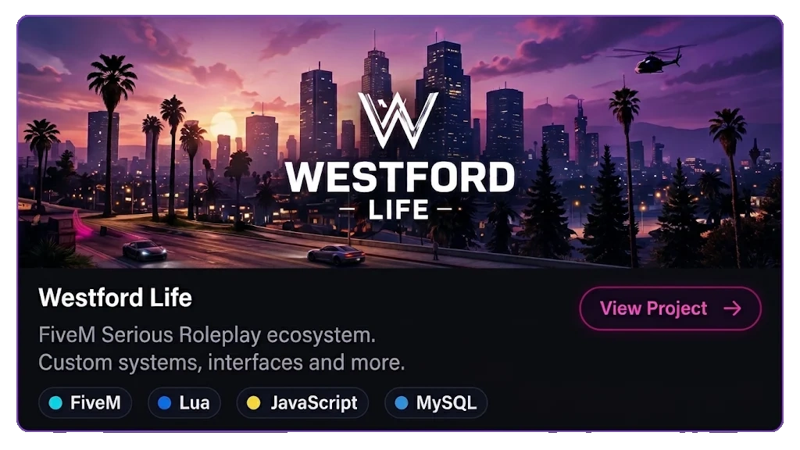
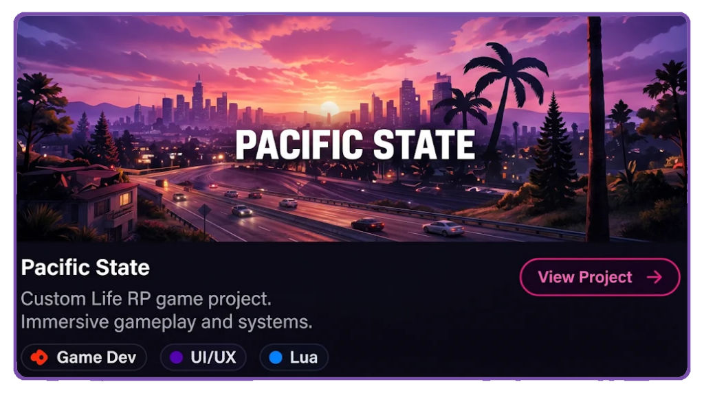
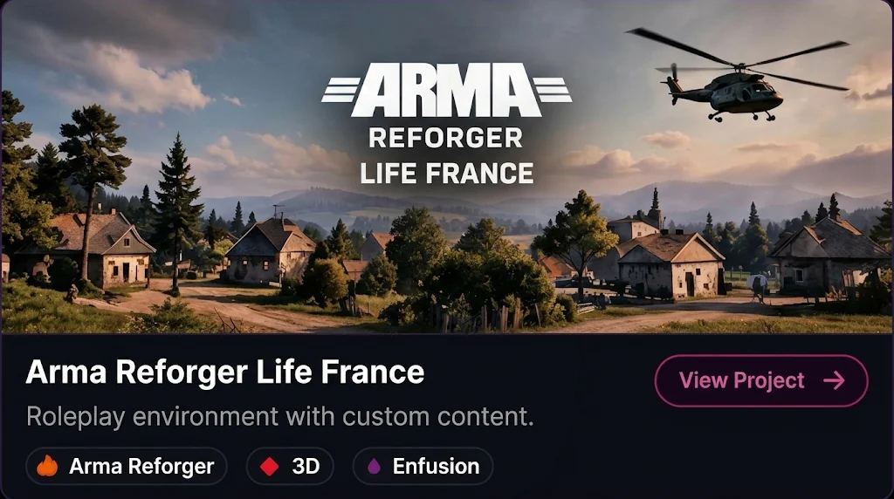
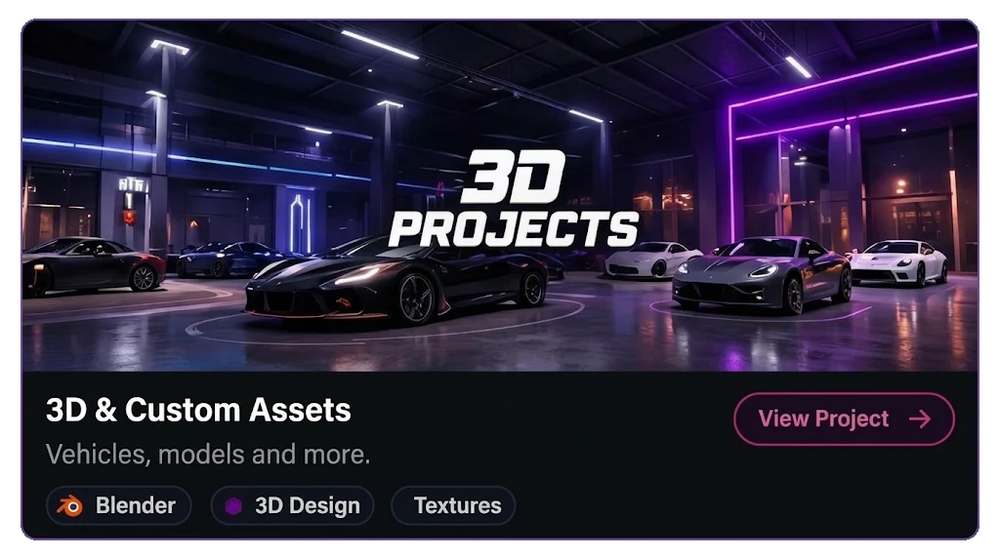

  
    
  
  
  

## 👨‍💻 About Me

I'm **ProXyS**, a developer interested in building complete digital experiences, custom game systems and modern applications. I enjoy taking projects from an initial idea to a polished result — combining development, design and technical problem-solving.

- 🎮 FiveM & GTA Roleplay development
- 🪖 Arma Reforger modding and roleplay environments
- 🌐 Web interfaces and application development
- 🧩 Custom systems, tools and integrations
- 🎨 3D assets, modelling and game-ready content

## 🧰 Technology Stack

  
   
  

## 🚀 Featured Projects

A selection of projects, environments and custom creations. The preview artwork below is illustrative; replace it with your own screenshots whenever you want to show actual in-game results.

<table>
  <tr>
    <td width="50%" valign="top">
      
      <h3>Westford Life</h3>
      
FiveM serious roleplay project — custom systems, server identity and immersive gameplay environment.

      FiveM · Roleplay · Development
    </td>
    <td width="50%" valign="top">
      
      <h3>Pacific State</h3>
      
Life RP game concept focused on its visual identity, player experience and custom gameplay systems.

      Game Development · UI · Systems
    </td>
  </tr>
  <tr>
    <td width="50%" valign="top">
      
      <h3>Arma Reforger Life France</h3>
      
Roleplay environment built around coherent locations, custom assets and immersive world design.

      Arma Reforger · Enfusion · Modding
    </td>
    <td width="50%" valign="top">
      
      <h3>3D & Custom Assets</h3>
      
Custom vehicles, 3D models, textures and visual assets created for game environments.

      Blender · 3D · Texturing
    </td>
  </tr>
</table>

## 📊 GitHub Statistics

  
  

  

  

---

  <b>BUILDING IDEAS INTO REALITY.</b>
    
  ProXyS © 2026 · Developer • Gamer • Creator

