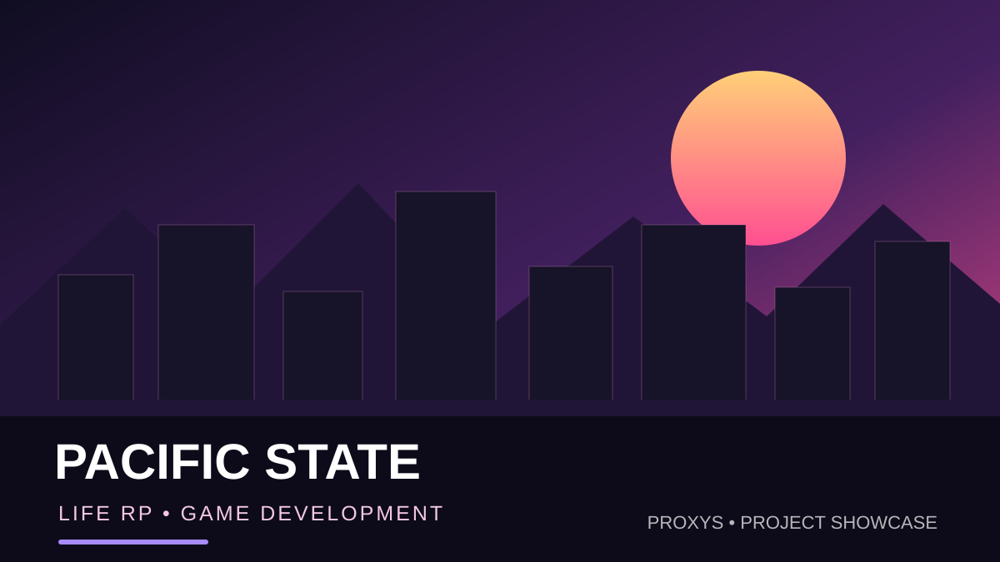
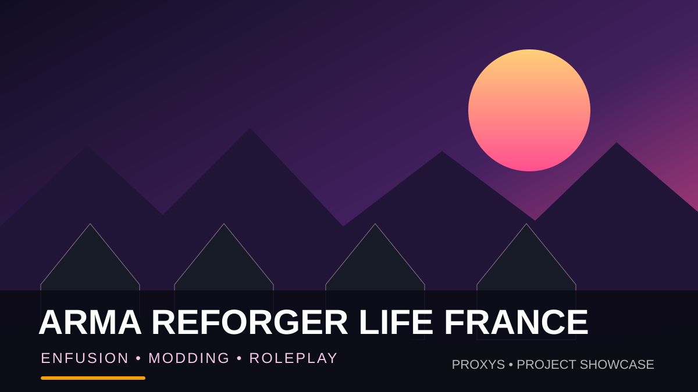

**DEVELOPER · GAMER · CREATOR**

*Building ideas into reality, one line of code at a time.*

---

<table>
<tr>
<td width="28%" valign="top">

## 👤 ProXySGit

**Developer & Creator**

📍 France

[GitHub Profile](https://github.com/ProXySGit)

---

### ⚡ Focus Areas
- 🎮 FiveM & GTA Roleplay
- 🪖 Arma Reforger
- 🌐 Full Stack Development
- 🧊 3D Modeling & Assets
- ⚙️ Backend & Systems

---

### 🌐 Find Me

</td>
<td width="72%" valign="top">

## ✨ About Me

I'm a developer focused on creating advanced systems, immersive gaming experiences and modern applications.

I enjoy transforming ideas into complete projects — from architecture and backend development to interfaces, game systems and 3D assets.

## 🧰 Technology Stack

## 🚀 Featured Projects

## 📊 GitHub Statistics

</td>
</tr>
</table>

---

 

 
© 2026 ProXyS · Building ideas into reality.

